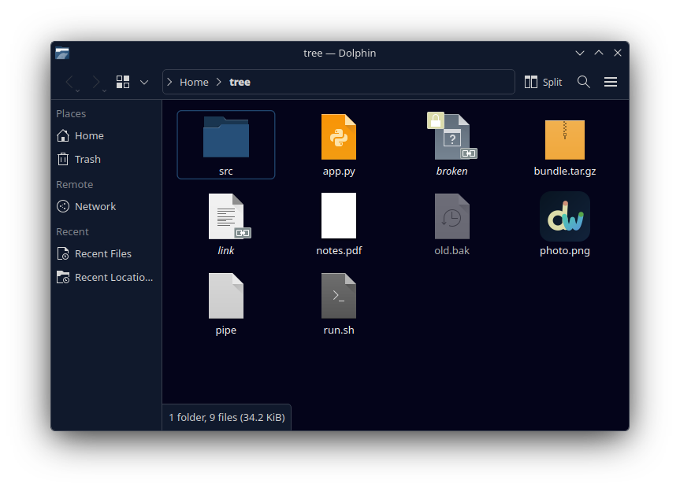

# Deepwick for KDE Plasma

A deep navy color scheme for Plasma and every Qt/KDE app: Dolphin, Okular,
Gwenview, Kate, Konsole's window, System Settings, and more.

> Deepwick is an unofficial theme derived from
> [Polywick Blue](https://vscode.polywickstudio.net) by Polywick Studio (MIT).
> Not affiliated with Polywick Studio.



## Install

```sh
mkdir -p "${XDG_DATA_HOME:-$HOME/.local/share}/color-schemes"
cp Deepwick.colors "${XDG_DATA_HOME:-$HOME/.local/share}/color-schemes/"
plasma-apply-colorscheme Deepwick
```

Or pick **Deepwick** in System Settings → Colors & Themes → Colors.

To theme a single app instead, use that app's Settings → Window Color Scheme.

GTK apps follow the scheme too: Plasma's GTK integration (kde-gtk-config)
translates it for Breeze GTK, with nothing extra to install. For GNOME apps that
use libadwaita, see [deepwick/libadwaita](https://github.com/deepwick/libadwaita).
For the Kate/KWrite editor area, see [deepwick/kate](https://github.com/deepwick/kate).

## Notes

- Neutral (warning) text is Yellow, where Breeze uses orange.
- Text on the selection uses Foreground, White and Light Blue, because Comment,
  Blue and Orange fall under 4.5:1 there. Negative and positive text on the
  selection keep Red and Green.
- Inactive and negative text in buttons (Comment and Red on Overlay) are
  4.3–4.4:1.
- `Deepwick.colors` is generated by `generate.py` from the Deepwick palette.

Tested with Plasma 6.7.5.

## License

MIT. See [LICENSE](LICENSE).
